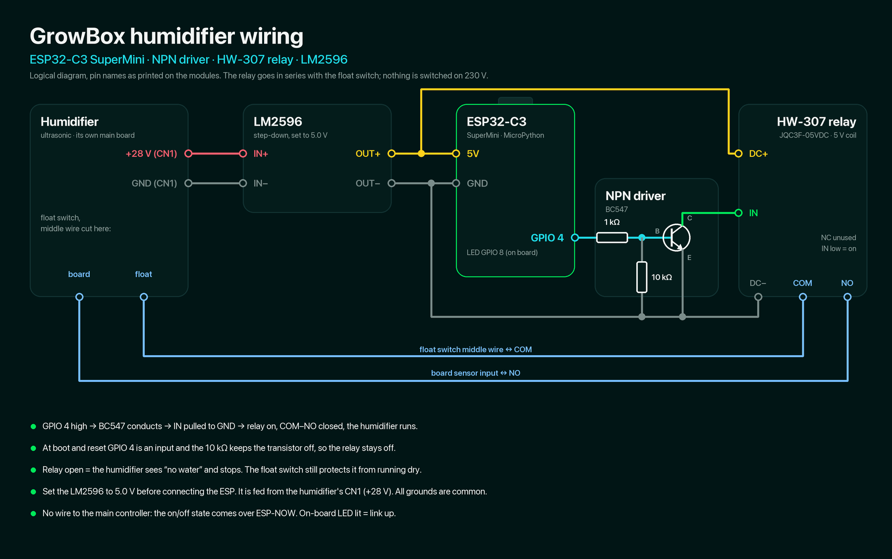

# Growbox humidifier

MicroPython firmware for the GrowBox humidifier: an ESP32-C3 SuperMini
sits inside an ultrasonic humidifier and switches it on and off with a
relay. The main controller ([firmware](https://github.com/growbox-DIY/firmware))
decides when it runs and sends the state over ESP-NOW; the mini switches
the relay and reports back. There is no wire between the two boards.

## Hardware



- **Wiring:** the relay (HW-307, JQC3F-05VDC, 5 V coil) is put in series
  with the humidifier's water level sensor (the middle wire of its float
  switch). Relay open = the humidifier sees "no water" and stops, so the
  float still protects it from running dry. Nothing is switched on 230 V.
- **Relay driver:** the HW-307 switches on a low input, and 3.3 V from
  the ESP does not switch it off, so an NPN pulls IN to GND:
  GPIO 4 → 1 kΩ → base (BC547), 10 kΩ base–GND, emitter to GND, collector
  to IN. GPIO high = relay on; at boot / reset the 10 kΩ keeps it off.
- **Power:** an LM2596 set to 5.0 V, fed from the humidifier's own supply
  (+28 V on its CN1), powers the mini and the relay module. Set the
  output before connecting the ESP.
- **Safety:** relay off at boot, after 20 s without a message from the main
  ESP, and on any error; hardware watchdog.
- **Status LED:** the on-board LED (GPIO 8) is lit while the link to the
  main ESP is up.

## Pairing

None needed. The mini listens on channels 1-13 until an ESP sends it a
state, remembers that ESP in `main_mac.txt` and searches again after a
few missed rounds, so the main ESP can be replaced without reflashing
the mini. The main ESP knows the mini by `humidifier.peer` in its
config. The main ESP follows the WiFi router's channel, and the mini
finds it again when that channel changes.

## Protocol

- main → mini: `HUM` + 0/1, every 5 s and on change
- mini → main: `HST` + relay state
- mini → main: `HEL` while searching for the channel; the ESP-NOW
  delivery ack comes back only on the channel the main ESP listens on

## Flash (USB)

The mini has no OTA. Flash MicroPython for the C3 (the image is in
`growbox-firmware/MicroPython`), then copy the firmware:

```bash
esptool --chip esp32c3 --port /dev/cu.usbmodem21101 erase-flash
esptool --chip esp32c3 --port /dev/cu.usbmodem21101 write-flash -z 0x0 ESP32_GENERIC_C3-20260824-v1.29.0.bin
mpremote connect /dev/cu.usbmodem21101 cp src/main.py :main.py
```

## Testing

`tools/sim_humidity.py` and `tools/sim_live.py` run the real humidifier
logic of the main controller (`src/humidifier.py` from growbox-firmware)
on a spare main ESP with a simulated humidity, for testing the whole
chain without a sensor. They go to RAM only and use the modules already
on that board:

```bash
mpremote connect /dev/cu.usbserial-0001 run tools/sim_humidity.py   # scripted profile, ~1.5 min
mpremote connect /dev/cu.usbserial-0001 run tools/sim_live.py       # type a humidity + Enter, q to quit
```

Set `peer` in their `CONFIG` to your mini's MAC address.

## Layout

```
src/
  main.py          mini ESP firmware (copied to the board as main.py)
tools/
  sim_humidity.py  end-to-end test with a scripted humidity
  sim_live.py      end-to-end test, humidity typed in the console
  gen_wiring.py    draws docs/wiring.png (needs Pillow)
```

## License

This project is licensed under [CC BY-NC 4.0](https://creativecommons.org/licenses/by-nc/4.0/):
you may use, share and modify it for non-commercial purposes, with credit to
growbox-DIY. See LICENSE.
